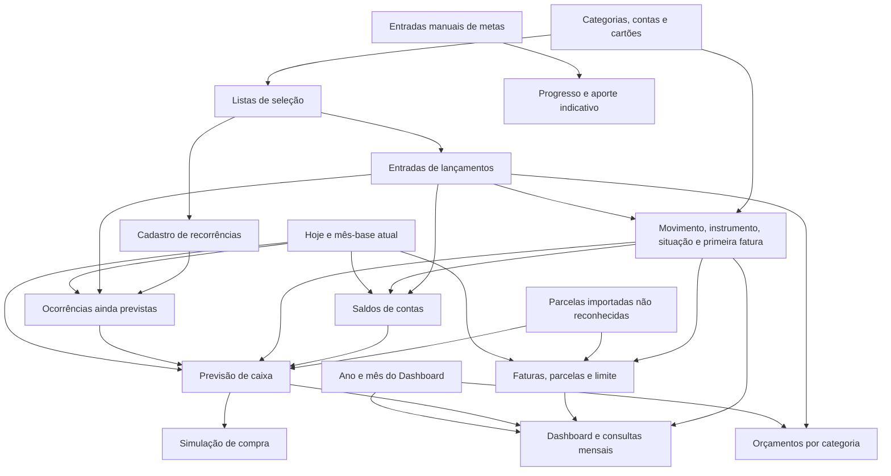

# Análise funcional da planilha de controle financeiro

Relatório para evolução do Saldo+ — 25 de outubro de 2026.

## 1. Escopo e método

Este relatório descreve as funcionalidades, os fluxos de registro, as fórmulas, as dependências e as limitações da planilha fornecida. O objetivo é transformar seu funcionamento em requisitos para o Saldo+. Os valores financeiros, os favorecidos e os hábitos de consumo registrados não são objeto da análise.

A inspeção cobriu todas as 24 abas, inclusive as ocultas, as colunas auxiliares, as fórmulas armazenadas, as validações, as regras de destaque, os comentários e as referências dos gráficos. O pacote XLSX foi lido diretamente, sem alterar a origem. A comparação com o sistema considera o código da branch `new-features`, no commit `6c09514`.

Foram identificadas 3.344 células com marcação de fórmula, 19 gráficos, 30 regras de validação e oito regiões com formatação condicional. A contagem de células inclui fórmulas compartilhadas e seus seguidores; fórmulas matriciais também produzem resultados em células sem fórmula própria. Portanto, essa contagem não corresponde ao número de regras de negócio distintas.

Há uma limitação relevante: 950 células contêm `__xludf.DUMMYFUNCTION`. Algumas preservam uma fórmula do ambiente de origem como texto; outras contêm apenas a indicação `COMPUTED_VALUE`, acompanhada de um resultado de contingência. A análise distingue a lógica recuperável dessas fórmulas dos resultados preservados. Não foi executado recálculo integral no Excel ou no Google Sheets, nem foi acessado o Apps Script vinculado à versão de origem. A ausência de erros nos resultados armazenados não comprova funcionamento após edição.

Além da leitura estrutural, foram realizados 19 controles independentes de inventário e regras. Os cenários sintéticos cobriram fechamento e vencimento de cartão, virada de ano, fevereiro e conservação dos centavos no parcelamento. Esses controles verificam a interpretação das fórmulas e não substituem um teste no aplicativo de planilhas.

## 2. O que a planilha oferece

A planilha combina quatro formas de observar as finanças:

| Visão | Pergunta respondida | Base usada |
| --- | --- | --- |
| Movimentação e consumo | O que recebi e em que gastei no período? | Data do lançamento, categoria, movimento e situação efetiva |
| Caixa | Quanto existe nas contas hoje? | Saldo inicial, recebimentos, pagamentos, transferências e quitação de faturas até hoje |
| Compromissos | Quanto já comprometi com cartões e obrigações? | Compras, parcelas, recorrências e pagamentos de fatura |
| Planejamento | Como ficará o saldo e quanto posso gastar? | Caixa atual mais entradas e saídas conhecidas dos próximos 12 meses |

O principal cuidado de integração é preservar essa separação. Uma compra no crédito pode aparecer integralmente na análise de gastos na data da compra, ser distribuída em parcelas na previsão e só retirar dinheiro da conta quando a fatura for paga. São efeitos diferentes do mesmo compromisso.

A planilha também oferece limites por categoria, metas de acumulação, simulação de compra e tratamento de parcelas importadas. O sistema atual cobre o registro e a análise histórica básicos, mas ainda não possui o modelo necessário para representar esses compromissos separadamente.

## 3. Inventário das abas

| Aba | Papel e entradas principais | Resultados e relações |
| --- | --- | --- |
| Dashboard | Seleção de ano, mês, conta e cartão | Indicadores, seis gráficos e comparação mensal; consulta lançamentos, previsão e cartões |
| Lançamentos | Receitas, despesas, investimentos, transferências e pagamentos de fatura | Fonte central dos movimentos realizados e agendados; possui seis colunas auxiliares ocultas |
| Previsão | Consolidação de compromissos e campos de uma compra hipotética | Projeção de 12 meses, saldo livre, disponibilidade diária e impacto da simulação |
| Recorrências | Regras de repetição, datas, valor, categoria e meio de pagamento | Obrigações e entradas ainda previstas; matriz oculta de 12 meses |
| Contas | Nome, tipo, saldo inicial, atividade e saldo informado | Saldo calculado e diferença para conciliação |
| Cartões | Banco associado, limite, fechamento, vencimento e atividade | Fatura, limite utilizado e disponível, próxima data de vencimento e compromissos futuros |
| Categorias | Nome, natureza do movimento e atividade | Classificação dos lançamentos e alimentação das listas de seleção |
| Orçamentos | Categoria e teto de gasto | Consumo do limite no período escolhido no Dashboard |
| Metas | Nome, objetivo, valor acumulado e data desejada | Valor faltante, progresso e aporte mensal indicativo |
| Configurações | Ano referenciado, moeda, região e fuso | Base temporal da previsão e parâmetros declarados |
| Janeiro a Dezembro | Doze consultas mensais com a mesma estrutura | Indicadores, gráfico por categoria, lançamentos e detalhamento de parcelas |
| Listas — oculta | Listas derivadas dos cadastros ativos | Validações de categoria, conta, cartão e filtros |
| Parcelas importadas — oculta | Obrigações de cartão recebidas de uma fonte anterior | Complementa faturas, limite e projeções sem repetir parcelas já reconhecidas |

Não foram encontrados módulos VBA, tabelas dinâmicas, conexões externas ou tabelas estruturadas do Excel no pacote. Os cadastros são intervalos comuns com filtros. Os comentários fazem referência a CSVs utilizados anteriormente, mas o arquivo não contém um importador executável desses CSVs.

## 4. Como os lançamentos funcionam

### 4.1. A aba possui três registros distintos

Embora compartilhem a mesma aba, os blocos abaixo representam operações diferentes. Estarem na mesma linha não estabelece uma relação entre eles.

| Bloco | Intervalo de entrada | Campos | Efeito |
| --- | --- | --- | --- |
| Lançamentos comuns | `A:I`, a partir da linha 5 | Data, descrição, categoria, valor, pagamento, conta/cartão, parcelas, situação e observação | Classifica receita, despesa ou investimento e alimenta relatórios e previsões |
| Transferências | `K:O`, a partir da linha 5 | Data, origem, destino, valor e observação | Diminui uma conta e aumenta outra, sem criar receita ou despesa de consumo |
| Pagamentos de fatura | `Q:T`, a partir da linha 5 | Data de pagamento, conta pagadora, cartão e valor | Diminui o caixa da conta e abate a dívida do cartão |

Essa divisão deve se tornar explícita na interface do sistema: registrar um gasto, transferir entre contas e pagar uma fatura precisam de fluxos próprios.

### 4.2. Campos do lançamento comum

| Campo | Comportamento observado |
| --- | --- |
| Data | Determina o período do lançamento; participa do cálculo da primeira fatura e dos cortes de caixa |
| Descrição | Texto livre; também é usado para reconhecer recorrências e parcelas importadas |
| Categoria | Selecionada de uma lista; sua natureza determina o movimento |
| Valor | Positivo; representa o total da compra quando há parcelamento, conforme a orientação da aba |
| Forma de pagamento | Pix, Dinheiro, Débito ou Crédito |
| Conta/Cartão | Campo compartilhado; deve representar uma conta para operações de caixa e um cartão para compras no crédito |
| Parcelas | Lista de `1x` a `36x`; vazio é interpretado como uma parcela |
| Situação | Pago, Pendente ou Recebido; a situação usada nos cálculos pode ser diferente do que foi digitado |
| Observação | Contexto livre, sem efeito identificado nas fórmulas de negócio |

Não há um campo visível de tipo do movimento. Receita, despesa e investimento são obtidos do cadastro da categoria. Consequentemente, mudar a natureza de uma categoria pode reclassificar lançamentos antigos no recálculo.

### 4.3. As seis colunas auxiliares ocultas

As colunas `V:AA` centralizam regras que o restante da planilha reutiliza:

| Coluna | Conteúdo calculado | Regra |
| --- | --- | --- |
| V | Movimento | Busca exata da categoria em `Categorias!A5:B200` |
| W | Número de parcelas | Retira o `x`, converte em número e usa 1 quando vazio ou inválido |
| X | Primeira fatura | Usa data da compra, fechamento e vencimento do cartão |
| Y | Identificador | Concatena `L-` com o número da linha |
| Z | Situação efetiva | Normaliza situação e aplica padrões automáticos |
| AA | Conta normalizada | Usa a conta/cartão informada; em dinheiro, substitui por `Dinheiro` |

São fórmulas matriciais com âncoras na linha 5. Poucas fórmulas escritas geram milhares de células auxiliares.

O identificador da coluna Y é uma referência de posição. Não é um identificador permanente: inserir ou reordenar linhas pode alterar seu significado. No sistema, o registro precisa de um ID persistente.

### 4.4. Situação digitada versus situação efetiva

A coluna Z aplica a seguinte ordem:

1. Sem data, o resultado fica vazio.
2. Despesa no crédito é tratada como `Pago`, independentemente de H.
3. Nos demais casos, uma situação preenchida em H é preservada.
4. Sem situação explícita, receita vira `Recebido` e os demais movimentos viram `Pago`.

Nesse modelo, `Pago` em uma compra no crédito significa reconhecimento do gasto na análise, e não quitação da fatura. A quitação é registrada no bloco Q:T.

A tela pode destacar H como `Pendente` enquanto os cálculos usam Z como `Pago`. Esse é um ponto de ambiguidade que não deve ser reproduzido no Saldo+.

### 4.5. Fluxos operacionais

- Receita recebida: registrar categoria de receita, conta, valor e data; o saldo da conta incorpora o recebimento até hoje.
- Receita esperada: registrar como pendente; entra na previsão do mês correspondente, sem aumentar o caixa atual.
- Gasto à vista: registrar categoria de despesa, meio de pagamento e conta; se pago e com data até hoje, reduz o caixa.
- Gasto pendente à vista: aparece como obrigação futura no período, sem reduzir o saldo atual.
- Compra no crédito: registrar uma vez o total e a quantidade de parcelas; a compra alimenta o consumo e suas parcelas alimentam as faturas.
- Transferência: usar origem e destino no bloco próprio; não cadastrar simultaneamente uma receita e uma despesa para representar a mesma transferência.
- Pagamento de fatura: informar cartão, conta pagadora, data e valor no bloco próprio; não registrar novamente como despesa de consumo.

Esses fluxos são observados na estrutura e nas fórmulas. A planilha aceita combinações que não são coerentes com eles, pois as validações não impõem todas as relações entre movimento, situação e instrumento de pagamento.

## 5. Contas, transferências e investimentos

### 5.1. Cadastro de contas

Há quatro tipos: conta corrente/digital, dinheiro, investimento e outro. Cada conta possui saldo inicial, indicador de atividade, saldo calculado e saldo informado para conferência.

A regra do saldo atual, em `Contas!D5`, equivale a:

```text
Saldo atual da conta =
  saldo inicial
  + receitas recebidas até hoje
  - despesas pagas sem crédito até hoje
  - investimentos pagos sem crédito até hoje
  - transferências enviadas até hoje
  + transferências recebidas até hoje
  - pagamentos de fatura feitos pela conta até hoje
```

As compras no crédito são excluídas da redução direta da conta. O dinheiro sai pelo pagamento de fatura, o que evita dupla contagem no caixa.

Não há data-base do saldo inicial. A fórmula adiciona todos os movimentos elegíveis ao saldo informado. Importar histórico anterior ao momento desse saldo pode contar a movimentação duas vezes. A migração precisa incluir uma data de abertura ou um corte de histórico.

### 5.2. Conciliação

`Contas!G5` calcula `saldo informado − saldo calculado`. A formatação destaca diferenças diferentes de zero quando existe saldo informado.

Isso é uma conferência de saldo, sem evidência de associação item a item com um extrato. Não há trilha de conciliação, data da conferência ou resolução automática da diferença.

### 5.3. Transferências

A mesma operação retira o valor da origem e o adiciona ao destino. Entre contas operacionais, o total consolidado se conserva. Uma transferência futura só passa a afetar os saldos atuais quando sua data chega.

As transferências para contas do tipo investimento têm uma consequência adicional: reduzem o conjunto de dinheiro considerado disponível para gastar. Na fórmula preservada como texto de `Previsão!F15`, aportes futuros líquidos em contas de investimento são tratados como saída da disponibilidade operacional.

### 5.4. O alcance do módulo de investimentos

A planilha diferencia categorias de investimento e contas de investimento. Ela não contém, nas fórmulas analisadas, carteira por ativo, cotação, rentabilidade, marcação a mercado, custo médio ou cálculo tributário.

O recurso que pode ser aproveitado é a separação entre dinheiro operacional e dinheiro reservado/investido. Para a integração, é necessário escolher uma representação única para aportes: lançar como investimento e também transferir o mesmo dinheiro pode duplicar efeitos se ambos os registros forem tratados como saídas independentes.

## 6. Cartões, faturas e parcelamento

### 6.1. Cadastro e indicadores

O cartão é um cadastro separado da conta e possui nome, banco associado, limite, dia de fechamento, dia de vencimento e atividade. A aba calcula fatura atual, limite utilizado, limite disponível, percentual utilizado, próximo vencimento, parcelas futuras e próxima fatura.

O banco associado é uma referência cadastral; a conta que efetivamente paga a fatura é escolhida no pagamento. O modelo permite, portanto, pagar um cartão com outra conta.

### 6.2. Cálculo da primeira fatura

A fórmula de `Lançamentos!X5` aplica:

```text
Deslocamento em meses =
  1 se o dia da compra for posterior ao fechamento, senão 0
  + 1 se o vencimento for menor ou igual ao fechamento, senão 0

Primeira fatura =
  mês da compra + deslocamento
  no dia de vencimento, limitado ao último dia desse mês
```

A compra feita no próprio dia de fechamento permanece no ciclo anterior à mudança, pois a comparação usa `>` e não `>=`. Se o cartão não é localizado, a fórmula assume fechamento no dia 10 e vencimento no dia 20. Esse padrão pode ocultar cadastro incompleto.

Exemplos sintéticos da regra: com fechamento 9 e vencimento 17, uma compra no dia 9 vence no mesmo mês; uma compra no dia 10 vence no seguinte. Com fechamento 20 e vencimento 10, a fórmula aplica um deslocamento adicional. Vencimentos no dia 31 são ajustados em meses curtos.

### 6.3. Distribuição das parcelas

As fórmulas identificam a diferença de meses entre o mês consultado e a primeira fatura. Há parcela quando essa diferença é maior ou igual a zero e menor que a quantidade total de parcelas.

Nas fórmulas com tratamento de arredondamento, a regra é:

```text
Parcela padrão = arredondar(total / quantidade, 2)
Última parcela = total − parcela padrão × (quantidade − 1)
```

Assim, uma compra hipotética de 100 em três vezes gera 33,33, 33,33 e 33,34. O ajuste preserva o total. As referências `Previsão!E15`, `Cartões!G5` e a fórmula textual do detalhe mensal contêm esse tratamento.

Entretanto, ele não é uniforme: as fórmulas de fatura dos demais cartões, a próxima fatura e o simulador usam divisão simples em trechos relevantes. O Saldo+ deve ter uma única regra de parcelamento, com dinheiro representado em centavos ou decimal exato.

### 6.4. Faturas e limite

As regras principais são:

- Fatura atual: parcelas que vencem no mês do próximo vencimento, menos pagamentos registrados naquele mês, mais recorrências de crédito previstas; o primeiro cartão também incorpora parcelas importadas.
- Limite utilizado: total das compras no crédito com data até hoje, menos pagamentos de fatura até hoje, limitado inferiormente a zero; no primeiro cartão, soma também o saldo de parcelas importadas.
- Limite disponível: limite cadastrado menos o utilizado, com piso em zero.
- Percentual: utilizado dividido pelo limite cadastrado.
- Próximo vencimento: usa a data de hoje e o dia configurado, ajustado ao fim do mês.
- Parcelas futuras: derivação do limite utilizado e da fatura atual, com ajuste para a parcela prevista das recorrências.
- Próxima fatura: aplica a lógica ao mês posterior ao próximo vencimento.

O limite é comprometido pelo total da compra, enquanto o desembolso é distribuído no tempo. As recorrências previstas podem compor a fatura projetada sem consumir, por antecipação, o limite realizado.

O pagamento não aponta para uma fatura identificada: o vínculo é inferido por cartão e mês da data do pagamento. Isso pode atribuir um pagamento antecipado ou atrasado ao período errado. A fórmula permite abater vários pagamentos no mesmo mês, mas não representa alocação de pagamento parcial a uma fatura, saldo rotativo, juros ou renegociação.

### 6.5. Parcelas importadas

A aba oculta recebe vencimento, descrição, categoria, valor, cartão e identificação da parcela. A coluna F guarda o valor ainda não reconhecido na base principal.

Uma parcela importada é zerada quando existe lançamento com a mesma descrição, valor, cartão e primeira fatura. A categoria não faz parte dessa comparação. Essa regra evita sobrepor obrigações antigas às compras ou parcelas posteriormente registradas.

É um mecanismo de continuidade de histórico, sem reconstrução obrigatória da compra original. Há indícios de registros históricos de parcelas individuais em descrições; por isso, a migração deve distinguir uma compra integral parcelada de uma parcela já isolada. Agrupar apenas por texto não é suficiente.

O tratamento das parcelas importadas foi inserido especificamente na primeira linha de cartão, `Cartões!G5`, `H5` e `M5`. As fórmulas das linhas seguintes não possuem a mesma inclusão. Esse comportamento é uma assimetria confirmada do arquivo, e não uma regra desejável para o produto.

## 7. Recorrências

### 7.1. O que pode ser cadastrado

Cada regra contém descrição, categoria, valor, dia, frequência, início, fim opcional, forma de pagamento, conta/cartão e atividade. O movimento é buscado na categoria, em K. As colunas ocultas L:W calculam os próximos 12 meses.

As frequências oferecidas são semanal, quinzenal, mensal, bimestral, trimestral, semestral e anual.

### 7.2. Como as ocorrências são calculadas

As frequências semanal e quinzenal usam passos de sete e 14 dias ancorados na data inicial. Assim, `Quinzenal` significa a cada 14 dias; não significa duas vezes por mês nem a cada 15 dias.

As frequências mensais usam intervalos de um, dois, três, seis ou 12 meses. O dia configurado é ajustado ao último dia do mês quando necessário. A diferença de meses em relação ao início precisa ser múltipla do intervalo.

Para operações sem crédito, a janela começa no maior valor entre início da recorrência, começo do mês e hoje. O limite superior é o menor entre fim da recorrência e fim do mês. Isso faz a previsão olhar para obrigações que ainda ocorrerão.

Uma regra vencida e não lançada não é carregada automaticamente como dívida atrasada: ao avançar a data de hoje, a ocorrência passada pode deixar de ser prevista. Essa diferença entre previsão futura e controle de inadimplência precisa ser resolvida no sistema.

### 7.3. Substituição da previsão pelo realizado

A planilha tenta retirar a previsão quando surge um lançamento correspondente:

- Sem crédito, conta lançamentos com a mesma descrição e categoria na janela definida e reduz a quantidade de ocorrências previstas.
- Com crédito, soma valores de lançamentos com a mesma descrição e categoria, forma Crédito e primeira fatura no mês. Divide esse realizado pelo valor recorrente para reduzir o montante previsto.

Em termos simplificados:

```text
Previsto sem crédito = máximo(0, ocorrências esperadas − lançamentos encontrados) × valor
Previsto no crédito = máximo(0, ocorrências do ciclo − realizado / valor) × valor
```

A associação não usa um ID de recorrência. No caso sem crédito, também não exige conta, situação ou igualdade de valor; no crédito, não exige igualdade de cartão. Dois compromissos com a mesma descrição e categoria podem se interferir. Um lançamento pendente pode retirar uma previsão sem confirmar a liquidação.

Nas frequências semanal e quinzenal, a janela de contagem de lançamentos pode alcançar o fim do mês, mesmo quando a recorrência termina antes. Essas aproximações devem ser substituídas por ocorrências identificadas individualmente.

### 7.4. Recorrências no cartão

As fórmulas separam trechos de dois meses de eventos em torno do fechamento para determinar o que pertence à fatura do mês. Portanto, a data do evento recorrente pode pertencer a um mês e seu pagamento pela fatura a outro.

Isso permite projetar assinaturas de cartão junto às compras já lançadas. A regra deve ser reaproveitada como geração de ocorrências e associação a faturas, sem copiar a grande fórmula matricial para o código.

### 7.5. Atalho “Lançar hoje”

A coluna X oferece o atalho. O comentário em `Recorrências!X4` informa que marcar a opção cria um lançamento na data de hoje e desmarca a caixa, mediante Apps Script vinculado.

Essa funcionalidade está documentada no arquivo, mas seu código não acompanha o XLSX e sua execução não foi verificada. No Saldo+, o equivalente seria uma ação de confirmar recebimento ou pagamento de uma ocorrência, com proteção contra repetição do clique.

## 8. Previsão financeira e simulador

### 8.1. Horizonte e ponto de partida

`Configurações!B3` calcula o primeiro dia do mês atual com `TODAY()`. A previsão começa nesse mês e avança mais 11 meses, inclusive atravessando o ano. Ela não acompanha o mês histórico escolhido no Dashboard.

O saldo de partida, em `Previsão!B3`, soma os saldos atuais das contas ativas cujo tipo não é investimento. Dinheiro reservado em contas de investimento fica fora da disponibilidade para gastar.

Trata-se de uma projeção baseada nos compromissos cadastrados. Não há fórmula identificada de previsão estatística de gastos variáveis, inflação, correção de valores, crescimento de renda ou rendimento automático de investimentos.

### 8.2. Composição mensal

| Coluna em A14:I26 | Conteúdo | Origem |
| --- | --- | --- |
| A — Mês | Chave mensal dos 12 períodos | Base da previsão e deslocamentos mensais |
| B — Saldo inicial | Caixa atual no primeiro mês; saldo final anterior nos demais | Contas e encadeamento de H |
| C — Receitas previstas | Recorrências de receita, lançamentos pendentes e recebimentos marcados como realizados com data futura | Recorrências e lançamentos |
| D — Gastos recorrentes | Recorrências de despesa e investimento ainda previstas | Matriz de recorrências |
| E — Compras parceladas/faturas | Parcelas que cabem no mês, abatidas de pagamentos até hoje, mais importadas não reconhecidas | Lançamentos, pagamentos de fatura e parcelas importadas |
| F — Outras saídas | Despesas e investimentos sem crédito pendentes ou futuros; aportes futuros líquidos em contas de investimento | Lógica preservada como texto em `DUMMYFUNCTION` |
| G — Resultado | Receitas menos as três classes de saída | C − D − E − F |
| H — Saldo final previsto | Saldo inicial mais resultado | B + G |
| I — Após simulação | Saldo final menos efeito acumulado da compra hipotética | H e parâmetros do simulador |

No mês corrente, a base já contém movimentos realizados até hoje; a projeção acrescenta o que ainda está previsto. Nos meses seguintes, o saldo é carregado mês a mês.

Há uma distinção importante em receitas e pagamentos com data futura: mesmo que a situação esteja marcada como recebida ou paga, o caixa atual não os incorpora antes da data. As fórmulas da previsão os incluem como eventos futuros. O sistema deve optar por permitir essa combinação com significado explícito ou exigir data real de liquidação separada da data prevista.

### 8.3. Indicadores de disponibilidade

As células B3:B11 apresentam:

```text
Entradas ainda esperadas = receitas previstas do mês atual
Contas ainda não pagas = recorrências + outras saídas previstas do mês
Próxima fatura = parcelas/faturas previstas do mês atual
Gastos futuros conhecidos = recorrências + faturas + outras saídas
Previsto no fim do mês = saldo final projetado do mês atual
Comprometido = gastos futuros conhecidos
Saldo livre = saldo disponível hoje − comprometido
Disponível por dia = máximo(0, saldo livre / dias restantes do mês, incluindo hoje)
```

O saldo livre não acrescenta as receitas ainda esperadas. É um indicador conservador baseado no dinheiro existente. O saldo final previsto acrescenta essas receitas. Ambos são úteis, mas respondem a perguntas diferentes.

Os dias do mês são dias corridos. O disponível por dia usa piso zero e não mostra, nesse indicador isolado, o tamanho de eventual insuficiência. A insuficiência continua aparecendo nos saldos.

### 8.4. Simulador de compra

Os campos E4:E8 recebem valor, data, forma de pagamento, cartão e parcelas. Os resultados são valor da parcela, primeira fatura, saldo após a compra no primeiro mês da projeção e menor saldo entre os 12 meses.

No crédito, o simulador aplica a regra de fechamento/vencimento e distribui o impacto pelas parcelas. Em I15:I26, o efeito é acumulado: cada saldo final perde todas as parcelas da simulação que já teriam vencido até aquele mês.

Em Pix, débito ou dinheiro, o total passa a reduzir os saldos a partir do mês da compra. A coluna O apresenta separadamente o impacto mensal da simulação no cartão.

É uma simulação: não foi identificado um comando no XLSX que transforme a hipótese em lançamento. Também não há bloqueio identificado por limite disponível, categoria orçamentária ou saldo insuficiente. A projeção mostra o impacto, mas não aprova a compra.

O alerta visual de saldo negativo em G:I usa exclusivamente `$H15<0`. Se a hipótese tornar apenas I negativo, a regra não detecta essa nova insuficiência. O produto deve avaliar separadamente o cenário base e o simulado.

### 8.5. Limites temporais da previsão

A previsão não constitui um histórico de previsões anteriores. Trocar o ano do Dashboard não recupera o que era esperado naquele momento. Meses fora da janela atual podem aparecer vazios, ou como zero em determinadas comparações com tratamento de ausência.

Pendências explícitas de meses anteriores também não são automaticamente carregadas para o mês corrente, pois as somas são feitas pelo mês do lançamento. O produto precisa de uma política para vencidos: mantê-los em aberto, reprogramá-los explicitamente ou apresentá-los separadamente, sem fazê-los desaparecer.

## 9. Dashboard e consultas mensais

### 9.1. Dashboard

Os sete indicadores são saldo atual, receitas do mês, gastos do mês, saldo do mês, fim do mês previsto, disponível para gastar e próxima fatura.

Os seis gráficos usam as seguintes bases:

| Gráfico | Dados que o alimentam |
| --- | --- |
| Receitas x despesas por mês | `Dashboard!A19:C31` |
| Gastos por categoria | `Dashboard!G19:H100` |
| Evolução do saldo previsto | `Dashboard!A19:A31` e `D19:D31` |
| Gastos dos últimos seis meses | `Dashboard!P19:Q25` |
| Previsto x realizado | `Dashboard!M19:O31` |
| Gastos por forma de pagamento | `Dashboard!J19:K23` |

Os gastos mensais e anuais usam a data do lançamento e a situação efetiva. Uma compra parcelada pode entrar com o valor total no mês da compra, enquanto a visão de parcelas mostra o compromisso por vencimento. O saldo acumulado em E20:E31 acumula receitas menos despesas do ano; ele não é a soma dos saldos bancários e não incorpora automaticamente o saldo de abertura das contas.

### 9.2. Os filtros não são globais

| Elemento | Ano/mês selecionados | Conta/cartão selecionados |
| --- | --- | --- |
| Receitas, despesas e saldo do período | Sim | Sim, nas fórmulas desses agregados |
| Série anual de receitas/despesas | Ano selecionado | Sim |
| Gráfico por categoria | Sim | Não |
| Gráfico por pagamento | Sim | Não; também não exige situação `Pago` |
| Gastos dos últimos seis meses | Janela relativa ao mês atual | Não |
| Saldo atual e disponível para gastar | Posição atual | Não |
| Saldo final previsto | Consulta a janela atual de previsão | Não |
| Indicador de fatura | Próximo vencimento calculado a partir de hoje | Filtra cartão, mas não conta |

Assim, trocar um filtro pode atualizar parte do painel e manter outra parte no consolidado. No Saldo+, cada indicador deve compartilhar o mesmo escopo ou declarar o próprio escopo claramente.

O filtro de conta compara a coluna AA, que contém nome de cartão nas compras de crédito. Selecionar uma conta e um cartão não estabelece automaticamente a relação de conta pagadora desse cartão; a conjunção dos filtros pode eliminar registros. Além disso, filtrar um cartão restringe a base a operações de crédito desse cartão, o que pode esvaziar as receitas.

### 9.3. “Previsto x realizado” exige redefinição

O previsto do gráfico soma recorrências, faturas e outras saídas da projeção atual. O realizado usa despesas reconhecidas por data do lançamento. As bases diferem tanto no tempo quanto no reconhecimento do crédito.

Além disso, a previsão do mês atual representa compromissos remanescentes: ela é reduzida conforme eventos são registrados. Não corresponde necessariamente ao orçamento original do mês. Compará-la diretamente ao realizado pode sugerir uma variação que é, na verdade, diferença de conceito.

Para o produto, há três métricas distintas: orçamento original, realizado e compromissos ainda abertos. A projeção atualizada do total do período seria realizado mais compromissos restantes, respeitando uma base única de reconhecimento.

### 9.4. Janeiro a Dezembro

As 12 abas mensais são consultas, sem necessidade de repetir os lançamentos manualmente. Cada uma mostra receitas, despesas, saldo, gastos por meio de pagamento, fim de mês previsto, categoria com maior gasto, maior lançamento de despesa e média diária.

O detalhamento reúne:

- Gráfico e total por categoria, em K:L.
- Lista de lançamentos do mês ordenada por data, a partir de A30:I.
- Lista de parcelas da fatura, em N:R, com descrição, categoria, valor, cartão e número da parcela.

A fórmula textual do detalhamento das parcelas combina compras da base com obrigações da aba oculta de importadas. Tenta extrair a indicação `n/m` do final da descrição; quando não encontra, monta essa indicação pela diferença de meses.

A média diária divide as despesas por todos os dias do mês, e não pelos dias já transcorridos. A fórmula textual do maior gasto não exige a situação efetiva de pago, embora o total de despesas a exija. Isso pode fazer os indicadores considerarem conjuntos diferentes.

As listas dinâmicas mensais estão entre os trechos afetados por `DUMMYFUNCTION`. Há evidência da intenção de funcionamento e dos resultados exportados, mas sua atualização no Excel não foi demonstrada.

Para o sistema, uma única tela de consulta com seletor de mês e abas internas de lançamentos e parcelas substitui as 12 cópias, preservando as funcionalidades.

## 10. Categorias, listas e configurações

### 10.1. Categorias

O cadastro admite três naturezas: Despesa, Receita e Investimento. O campo de atividade é usado para retirar opções dos novos registros sem necessariamente apagar o histórico.

As fórmulas de classificação fazem busca por nome. Duplicidade e renomeação podem gerar ambiguidades; não há uma chave estável de categoria nas linhas. A busca da primeira correspondência também não distingue categorias homônimas por natureza.

### 10.2. Listas auxiliares

A aba oculta Listas organiza:

| Coluna | Intenção da lista |
| --- | --- |
| A | Categorias ativas |
| B | Contas ativas |
| C | Cartões ativos |
| D | União sem duplicações de contas e cartões |
| E | Categorias ativas de despesa, para orçamentos |
| F | Contas para o filtro, precedidas de `Todas` |
| G | Cartões para o filtro, precedidos de `Todos` |

Essa separação viabiliza seletores alimentados pelos cadastros. No arquivo exportado, várias listas usam fórmulas de contingência que preservam opções anteriores; portanto, não se pode assumir que inativar um cadastro atualizará todas as listas no Excel.

### 10.3. Configurações e datas

O ano em Configurações!B2 referencia Dashboard!B2. A base da previsão, em B3, é independente e usa o mês atual. Moeda, região e fuso estão declarados como BRL, pt-BR e America/Sao_Paulo.

Nas fórmulas inspecionadas, apenas B2 e B3 são referenciados como parâmetros de cálculo. Não há evidência de conversão cambial ou aplicação programática das células de região/fuso. Esses textos não demonstram, por si só, que as funções de data obedecerão a esse fuso no aplicativo que abrir o arquivo.

As validações oferecem seleções e checagens locais, mas não equivalem a integridade de banco de dados. Há inclusive uma exceção na faixa de frequência das recorrências: E32 fica fora da lista de frequências e aparece em uma validação numérica junto a D32. É uma inconsistência de intervalo do arquivo.

## 11. Orçamentos e metas

### 11.1. Orçamentos por categoria

O usuário informa categoria de despesa e limite. A planilha calcula:

```text
Gasto = despesas com situação efetiva Pago da categoria no mês/ano do Dashboard
Restante = limite − gasto
Percentual utilizado = gasto / limite
```

As faixas de destaque são menos de 70%, de 70% a menos de 90%, de 90% a 100%, e acima de 100%. Limite vazio ou zero deixa o percentual sem resultado.

O orçamento não guarda ano e mês em cada registro. O mesmo conjunto de limites é aplicado ao período selecionado, sem histórico próprio de versões. Tampouco segue os filtros de conta/cartão do Dashboard.

O gasto no crédito segue o valor e a data da compra, e não as parcelas da fatura. Pendências não entram quando a situação efetiva não é paga. Portanto, o orçamento de consumo tem base diferente da previsão de caixa.

Há validação e formatação até a linha 200, mas as fórmulas de cálculo existem até a linha 100. São 96 posições calculadas, das linhas 5 a 100. O produto deve substituir essa limitação por registros de orçamento vinculados a categoria e período.

### 11.2. Metas de acumulação

Os campos editáveis são nome, valor desejado, valor atual e data desejada. As fórmulas são:

```text
Falta = máximo(0, desejado − atual)
Progresso = mínimo(1, atual / desejado)
Meses restantes = máximo(0, diferença em meses de calendário entre hoje e a data desejada)
Guardar por mês = falta / meses restantes, se meses restantes for maior que zero
```

A coluna I usa uma sequência de até 20 pontos para representar o progresso. O cálculo de meses ignora o dia dentro do mês. Uma meta para o mês atual, ou com prazo vencido, deixa o aporte mensal em branco em vez de apresentar um estado específico.

O valor atual é manual. Não há vínculo identificado com saldo de conta, investimento, contribuição ou lançamento. As metas também não reservam dinheiro nem acrescentam aportes à previsão automaticamente.

Assim como em orçamentos, as fórmulas estão preparadas até a linha 100, embora haja validação de data até a linha 200.

## 12. Como as abas interagem

O diagrama abaixo agrupa as dependências por função. Os fluxos indicam alimentação de dados ou de regras, e não necessariamente uma referência direta entre todas as células dos grupos.



As metas são um módulo independente. Os orçamentos dependem dos gastos e do período, mas não alimentam a previsão. A previsão não impede novos gastos. O principal fluxo de conciliação entre previsto e realizado ocorre nas recorrências e nas parcelas importadas.

### Famílias de fórmulas e seus papéis

| Família | Exemplos identificados | Função de negócio |
| --- | --- | --- |
| Agregações condicionais | `SUMIFS`, `COUNTIFS`, `SUMPRODUCT` | Saldos, consumo, pagamentos, parcelas e reconhecimento de recorrências |
| Busca e classificação | `VLOOKUP`, `INDEX`, `MATCH`, `IFNA` | Movimento da categoria, parâmetros de cartão e consulta ao mês previsto |
| Calendário | `TODAY`, `DATE`, `YEAR`, `MONTH`, `DAY`, `EDATE`, `EOMONTH` | Cortes temporais, fechamento, vencimento, períodos e meses restantes |
| Recorrência | `SWITCH`, `MOD`, `INT`, `ROUNDUP`, `MIN`, `MAX` | Intervalos de dias e meses e contagem de ocorrências |
| Precisão e limites | `ROUND`, `MIN`, `MAX` | Ajuste da última parcela, pisos de saldo e teto visual de progresso |
| Normalização | `IF`, `IFERROR`, `VALUE`, `SUBSTITUTE`, `TEXT`, `ROW` | Quantidade de parcelas, situação efetiva, conta de dinheiro e ID posicional |
| Matrizes e consultas | `MAP`, `LAMBDA`, `LET`, `FILTER`, `SORT`, `HSTACK`, `VSTACK`, `UNIQUE`, `TOCOL`, `CHOOSECOLS` | Colunas auxiliares, projeções por registro, listas e combinação de detalhes |
| Texto de parcela e progresso | `REGEXEXTRACT`, `REPT` | Identificação visual de parcelas e barra textual de metas |
| Contingência de exportação | `__xludf.DUMMYFUNCTION`, `COMPUTED_VALUE` | Preservação de fórmulas/textos ou resultados incompatíveis com a exportação |

Parte das funções da tabela aparece dentro de texto passado a `DUMMYFUNCTION`, e não como expressão diretamente executável. Isso é particularmente relevante para `ARRAYFORMULA` e `REGEXEXTRACT`, presentes no detalhamento mensal exportado.

## 13. Pontos frágeis que a integração deve corrigir

Os itens abaixo descrevem comportamentos encontrados no arquivo. Não foram realizadas correções na planilha.

| Prioridade | Achado e evidência | Consequência | Tratamento proposto |
| --- | --- | --- | --- |
| Alta | `DUMMYFUNCTION` em listas, detalhes mensais e saídas previstas | Resultados de contingência podem continuar visíveis sem recalcular a lógica original | Reimplementar regras de domínio e validar por cenários, sem usar resultados exportados como motor de cálculo |
| Alta | Situação de despesa no crédito forçada a Pago em `Lançamentos!Z5` | Mistura reconhecimento do gasto com liquidação da dívida | Estados separados para compra, parcela, fatura e pagamento |
| Alta | Pagamento associado ao cartão e mês da data de pagamento | Antecipação e atraso podem abater uma fatura diferente | Pagamento vinculado a uma fatura identificada |
| Alta | Recorrências reconhecidas por texto e categoria | Eventos parecidos, pendentes ou de instrumentos diferentes podem se compensar indevidamente | ID de regra e ID de ocorrência, com vínculo explícito ao lançamento |
| Alta | Corte por hoje nas recorrências e filtros por mês nas pendências | Obrigações passadas não liquidadas podem sumir da previsão corrente | Manter vencidos em aberto e explicitar reprogramação |
| Alta | Contas sem data-base de saldo inicial | Histórico importado pode duplicar efeitos já incorporados ao saldo | Saldo de abertura com data e corte de migração |
| Alta | Compras e pagamentos medidos por datas diferentes | Copiar agregações sem definir conceitos pode duplicar ou deslocar gastos | Separar consumo, caixa, compromissos e orçamento |
| Média | Importadas incluídas apenas no primeiro cartão | Demais cartões não recebem o mesmo tratamento | Cálculo genérico por ID de cartão |
| Média | Arredondamento não uniforme entre faturas e simulação | Pequenas diferenças entre total da compra e somatório de parcelas | Único serviço de distribuição de parcelas e precisão monetária exata |
| Média | Filtros parciais do Dashboard | Indicadores lado a lado podem representar universos distintos | Escopo consistente e explícito para todos os componentes |
| Média | Previsto remanescente comparado a despesa por data da compra | Gráfico sugere comparação de orçamento com bases incompatíveis | Definir orçamento original, realizado e restante na mesma base |
| Média | ID de lançamento depende da linha e categorias dependem do nome | Ordenar, inserir ou renomear pode alterar associações | IDs persistentes e referências estáveis |
| Média | Limites de orçamento sem chave de período | Alterar um teto muda a interpretação de outros meses | Orçamentos versionados por competência |
| Média | Orçamentos e metas calculam até a linha 100, mas validam até 200 | Novos registros podem parecer aceitos e ficar sem cálculo | Consultas sobre registros, sem limite físico de linhas |
| Média | Alerta de previsão olha H, sem avaliar o cenário I | Uma compra hipotética pode gerar saldo negativo sem novo destaque | Alertas separados para base e simulação |
| Média | Parâmetros padrão de cartão e parcelas inválidas convertidas em 1 | Entrada incompleta pode gerar uma projeção aparentemente válida | Exigir parâmetros de cartão e validar parcelamento |
| Baixa | Validação de recorrência com exceção indevida na linha 32 | Uma linha aceita um tipo de dado diferente das demais | Validação centralizada, independente de posição |
| Baixa | Metas vencidas deixam aporte mensal vazio | Falta um estado operacional para meta em atraso | Estados de meta e regra explícita para prazo vencido |

O arquivo não oferece evidência de regras completas para estorno, reembolso, chargeback, cancelamento de compra parcelada, juros, rotativo ou renegociação. Esses recursos devem ser tratados como extensões de produto, e não como funcionalidades já implementadas na planilha.

## 14. Comparação com o Saldo+ atual

A avaliação abaixo se baseia no schema Prisma, nas validações, nas ações de transações, nas consultas de estatísticas e nas telas existentes. Não foi necessário acessar o banco de dados nem executar operações financeiras.

| Capacidade | Situação no código atual | Evolução necessária |
| --- | --- | --- |
| Criar, editar e excluir receitas/despesas | Implementado com `Transaction` e ações próprias | Manter os fluxos e ampliar os conceitos sem alterar silenciosamente o significado histórico |
| Categorias com natureza | `income` e `expense`, nome e ícone | Adicionar IDs de referência, atividade e política para investimentos |
| Bancos | Cadastro com nome e informações opcionais de cartão | Separar instituição, conta financeira e cartão |
| Conta com saldo inicial e saldo calculado | Não identificado | Novo cadastro financeiro com data de abertura, tipo e movimentos |
| Conta em receitas | Schema admite `bankId`, mas o seletor de banco é exibido no bloco de despesas | Oferecer conta de recebimento de forma consistente |
| Cartão e forma de pagamento | Formas já incluem crédito/débito; `Bank` guarda limite e vencimento | Cartão independente, fechamento, ciclos e dívida |
| Parcelas | Não identificado | Compra original, cronograma de parcelas e ajustes de centavos |
| Pagamento de fatura | Não identificado | Fatura, pagamentos vinculados e efeito separado no caixa |
| Situação e liquidação | `Transaction` não possui esses campos | Previsto, pendente, liquidado, cancelado e datas apropriadas |
| Transferência entre contas | A opção de pagamento `transfer` é um rótulo, sem origem/destino no modelo | Operação com duas pontas e preservação do consolidado |
| Investimento como reserva/transferência | Não identificado como domínio próprio | Tipo de conta e política de aportes e resgates |
| Recorrências e confirmação rápida | Não identificado | Regra, ocorrências e confirmação com prevenção de duplicação |
| Previsão de caixa e disponível diário | Não identificado | Serviço de projeção com horizonte e data de referência |
| Simulação de compra | Não identificado | Cálculo temporário sobre a mesma regra de faturas e caixa |
| Orçamento por categoria | Não identificado | Limites por período, consumo e alertas |
| Metas | Não identificado | Objetivo, contribuições ou saldo manual e cálculo de prazo |
| Relatórios e filtros | Dashboard por intervalo, categorias, histórico e tabela com filtros | Acrescentar consumo versus caixa, situação, cartão e compromissos |
| Importação | Exportação CSV identificada; importação não identificada | Entrada revisável com origem, mapeamento e deduplicação |
| Preferências | Moeda no `UserSettings` | Região, fuso e políticas de cálculo quando necessários |

### 14.1. O “Saldo” atual tem outro significado

Em `src/components/stats_cards/index.tsx`, o saldo é `income − expense` do intervalo consultado. A consulta de `src/app/api/stats/balance/route.ts` agrupa `Transaction` por tipo e data.

Esse número é o resultado do período. Não representa, por si só, dinheiro disponível em contas, pois não há saldo de abertura, liquidação, transferências ou dívida de cartão no cálculo atual.

Ao introduzir contas, o painel deve diferenciar pelo menos “resultado do período”, “saldo em contas” e “saldo livre após compromissos”.

### 14.2. Agregados históricos precisam acompanhar a evolução do domínio

`MonthHistory` guarda totais diários e `YearHistory`, totais mensais. Criar, editar e excluir transações atualiza esses agregados, considerando os dois tipos atuais.

Acrescentar apenas um campo de situação, sem rever essas rotinas, faria lançamentos pendentes continuarem entrando nos históricos como se fossem realizados. O mesmo risco existe se parcelas e pagamentos de fatura forem introduzidos como novas despesas comuns.

Os agregados atuais também não guardam dimensões de conta, cartão, categoria ou critério de reconhecimento. Será necessário calcular consultas adicionais sobre as fontes ou redesenhar os agregados para as visões necessárias. A reconstrução a partir dos registros deve ser possível para verificar sua consistência.

### 14.3. Pontos do modelo a considerar antes de ampliar

- `Transaction.amount`, `Bank.cardLimit` e os agregados usam `Float`. Parcelamento e quitação pedem uma política de precisão monetária consistente, como inteiro em centavos ou decimal exato.
- `Transaction.category` é texto e `bankId` não possui relação Prisma declarada. A evolução deve introduzir vínculos que possam ser validados.
- O cadastro atual permite o mesmo nome de categoria em tipos diferentes, mas as ações de criar/editar transação procuram categoria por nome e usuário, sem restringir o tipo. Ampliar a classificação exige eliminar essa ambiguidade.
- Já existe um modelo chamado `Account`, utilizado pelo Better Auth para contas de autenticação. O novo cadastro financeiro deve ter outro nome, como `FinancialAccount`.
- O histórico usa meses de 0 a 11. A planilha trabalha com seleções de 1 a 12. O mapeamento de importação precisa converter essa representação explicitamente.
- As rotinas de agregação usam componentes UTC, enquanto `DateToUTCDate()` constrói uma data local e não converte explicitamente para UTC. A ampliação deve definir datas financeiras no fuso do usuário e testar os limites de dia e mês.

## 15. Proposta de integração funcional

As propostas desta seção são decisões de arquitetura sugeridas para o Saldo+, e não funcionalidades comprovadas da planilha.

### 15.1. Modelo de domínio proposto

| Conceito | Responsabilidade | Relações e atributos essenciais |
| --- | --- | --- |
| Conta financeira | Caixa, carteira ou reserva | Usuário, instituição opcional, tipo, atividade, saldo de abertura e data-base |
| Categoria | Natureza e agrupamento do movimento | ID persistente, nome, natureza, atividade; política de preservação histórica |
| Lançamento | Receita ou obrigação registrada | Categoria, descrição, valor, datas prevista e efetiva, situação e instrumento |
| Compra no cartão | Origem de uma obrigação parcelada ou única | Cartão, data, total, quantidade de parcelas e referência externa opcional |
| Parcela | Parte da obrigação em um ciclo | Compra, número, valor exato, vencimento e fatura |
| Fatura | Agrupamento de obrigações do cartão | Cartão, ciclo, fechamento, vencimento, itens, pagamentos e saldo em aberto |
| Pagamento de fatura | Liquidação de dívida usando caixa | Fatura, conta pagadora, data e valor; pode haver mais de um por fatura |
| Transferência | Movimento entre duas contas | Origem, destino, data e valor em uma operação atômica |
| Regra recorrente | Definição de um compromisso repetido | Frequência, intervalo, início, fim, valor, categoria e instrumento |
| Ocorrência recorrente | Evento individual esperado | Regra, data prevista, situação e vínculo opcional ao lançamento confirmado |
| Orçamento | Limite por categoria e período | Categoria, competência, limite e critério de consumo |
| Meta | Objetivo de acumulação | Desejado, prazo, progresso e origem do valor acumulado |
| Conciliação | Comparação com posição externa | Conta, data de referência, saldo externo, diferença e resolução |
| Lote/item de importação | Rastreabilidade de origem | Arquivo/lote, chave externa, mapeamento, tipo de registro e resolução de duplicatas |

Uma projeção pode ser calculada sob demanda, sem armazenar uma transação para cada valor apresentado. Se houver necessidade de comparar previsões de épocas diferentes, devem ser guardadas versões com data de referência. A simulação deve trabalhar sobre um cenário temporário, sem criar obrigações reais.

### 15.2. Regras que devem permanecer únicas no sistema

1. Todo registro financeiro pertence a um usuário; vínculos entre conta, cartão, categoria e lançamento devem respeitar esse proprietário.
2. Compra no crédito compromete limite e gera parcelas, sem retirar caixa diretamente.
3. Pagamento de fatura retira caixa e reduz dívida, sem criar novamente a despesa de consumo.
4. Transferência conserva o total entre contas; mudar de conta operacional para investimento altera disponibilidade, sem criar consumo.
5. Parcelas devem somar exatamente o total da compra e ter identificação permanente.
6. Confirmação de recorrência substitui a ocorrência prevista por um vínculo com o realizado. Repetir a confirmação não deve gerar outro evento.
7. Compromissos vencidos continuam visíveis enquanto não forem liquidados, cancelados ou reprogramados.
8. Saldo atual incorpora somente movimentos efetivos até a data de referência e respeita a data-base de abertura.
9. Orçamento calcula consumo com um critério definido: data da compra, competência ou outro. O usuário deve conseguir distinguir esse critério da saída de caixa.
10. Editar ou excluir um registro atualiza seus efeitos derivados, preservando a consistência de parcelas, faturas, saldos e históricos.
11. Renomear ou inativar um cadastro não rompe registros históricos. A mudança de natureza de categoria precisa de política explícita.
12. Toda tela declara período, escopo e critério de reconhecimento dos números que apresenta.

### 15.3. Organização sugerida das telas

| Área | Conteúdo funcional |
| --- | --- |
| Visão geral | Caixa atual, resultado do período, compromissos, saldo livre, projeção e alertas |
| Lançamentos | Receitas/despesas, situação, datas, conta/cartão, observações e vínculos de origem |
| Contas | Saldos, abertura, atividade, transferências e conciliação |
| Cartões | Compras, parcelas, faturas, pagamentos, limite e próximos ciclos |
| Recorrências | Regras, calendário de ocorrências, vencidos e confirmação rápida |
| Planejamento | Previsão de caixa, orçamento por categoria e simulação de compra |
| Metas | Objetivos, progresso, prazo e contribuições, conforme a opção de vínculo escolhida |
| Importação | Revisão de categorias, contas, cartões, compras integrais, parcelas e duplicatas |

As consultas mensais podem ser uma visão dessas áreas, com um seletor único de período. Não há necessidade funcional de reproduzir as 12 abas como 12 páginas independentes.

## 16. Sequência proposta de implementação

### Etapa 1 — Fundamentos do caixa e integridade

Implementar contas financeiras com abertura datada, IDs de categoria, precisão monetária, datas/situações e transferências. Adaptar criação, edição, exclusão e agregados históricos. Introduzir conferência de saldo.

**Resultado verificável:** o saldo de uma conta pode ser explicado pelos seus movimentos; transferir entre contas não muda receita/despesa nem o consolidado; eventos previstos não alteram o caixa realizado.

### Etapa 2 — Cartões e compromissos parcelados

Separar cartão do banco, cadastrar fechamento/vencimento, criar compras e parcelas, agrupar faturas e registrar pagamentos vinculados. Incorporar obrigações históricas importadas de maneira genérica para todos os cartões.

**Resultado verificável:** uma compra parcelada aparece uma vez na origem, gera cronograma exato, compromete limite e só reduz a conta no pagamento da fatura.

### Etapa 3 — Recorrências e previsão de caixa

Implementar regras e ocorrências identificadas, confirmação rápida, vencidos, substituição do previsto pelo realizado e projeção de 12 meses. Exibir saldo livre e disponibilidade diária com definições claras.

**Resultado verificável:** registrar uma ocorrência não duplica a previsão; obrigações vencidas permanecem visíveis; cada linha da projeção pode ser detalhada até suas fontes.

### Etapa 4 — Planejamento e relatórios ampliados

Adicionar simulador, orçamentos por período, metas e novos indicadores. Uniformizar filtros e separar realizado, orçamento e compromissos remanescentes. Se desejado, guardar versões de previsão para comparação histórica.

**Resultado verificável:** a simulação não altera dados reais; o orçamento possui histórico; os filtros usam escopo consistente; as comparações apresentam o mesmo critério temporal e de reconhecimento.

O fluxo de importação deve ser planejado desde o início para preservar a origem dos registros, mas a carga financeira só deve acontecer após os fundamentos e as regras de cartão estarem definidos. Esta análise não executou importação nem migração.

## 17. Cenários de aceitação para a implementação

Os cenários abaixo constituem uma proposta de validação do produto. Apenas os controles sintéticos descritos no método foram executados nesta análise.

| Cenário | Resultado esperado no Saldo+ |
| --- | --- |
| Receita prevista é confirmada | Caixa aumenta uma vez e o compromisso esperado deixa de ser somado separadamente |
| Despesa pendente é paga | Caixa diminui na data efetiva, com rastreabilidade da data prevista |
| Transferência entre duas contas operacionais | Origem diminui, destino aumenta e resultado do período se conserva |
| Aporte em conta de investimento | Patrimônio entre contas se conserva; disponibilidade operacional cai conforme a política definida |
| Compra à vista no cartão | Limite é comprometido e há uma parcela na fatura correta, sem débito imediato em conta |
| Compra no dia do fechamento e no dia seguinte | Cada compra respeita a convenção de ciclo escolhida |
| Vencimento 29, 30 ou 31 em fevereiro | Data permanece válida, incluindo ano bissexto |
| Parcelamento com resto de centavos | Soma das parcelas é exatamente o total da compra |
| Parcelamento atravessa dezembro | Parcelas continuam no ano seguinte sem depender de uma aba anual |
| Pagamento parcial de fatura | Somente o valor pago reduz caixa e dívida; saldo não pago continua associado à fatura |
| Fatura paga antecipadamente ou em atraso | Pagamento reduz a fatura escolhida, independentemente do mês de pagamento |
| Segunda conta paga o cartão de outro banco | O caixa sai da conta escolhida e a dívida correta é reduzida |
| Recorrências com a mesma descrição em cartões diferentes | Confirmar uma não reduz a outra |
| Confirmação repetida de uma ocorrência | Uma única realização é criada |
| Recorrência semanal/quinzenal com término no meio do mês | Apenas as ocorrências válidas são geradas e associadas |
| Obrigação vencida sem realização | Permanece aberta, sem desaparecer pela passagem dos dias |
| Parcela histórica aparece novamente em uma importação | O sistema propõe conciliação da duplicata, sem somar duas obrigações |
| Categoria é renomeada ou inativada | Histórico continua íntegro e novos seletores respeitam a atividade |
| Limite orçamentário muda em outro mês | Meses anteriores preservam seu limite |
| Compra simulada torna o saldo negativo | Cenário simulado exibe a insuficiência, sem alterar o cenário real |
| Filtro de conta ou cartão é aplicado | Indicadores comparáveis usam o mesmo escopo ou indicam explicitamente exceções |
| Lançamento é editado ou excluído | Saldos, compromissos e agregados voltam a reconciliar |
| Registro perto da meia-noite ou fim de mês | Dia e competência permanecem corretos no fuso financeiro escolhido |
| Saldo de abertura já inclui histórico anterior | Histórico não é contado novamente no saldo atual |

## 18. Cuidados para uma futura migração dos registros

1. Definir a data de corte e o que já está incluído no saldo de abertura de cada conta.
2. Migrar cadastros com IDs próprios e um mapa de nomes antigos, preservando categorias inativas necessárias ao histórico.
3. Ler separadamente os três blocos da aba Lançamentos. A linha física não vincula automaticamente compra, transferência e pagamento de fatura.
4. Distinguir total de compra, parcela isolada já lançada e parcela futura importada. Não multiplicar uma parcela histórica como se ela fosse o total da compra.
5. Preservar a situação original e registrar a regra usada para interpretar a situação efetiva, especialmente no crédito.
6. Resolver duplicatas por origem e vínculo revisável. Descrição e valor podem servir como indício, sem provar identidade.
7. Identificar pagamentos históricos sem conta informada. O arquivo documenta um acerto desse tipo para evitar novo efeito sobre um saldo que já o incorporava. Um evento assim precisa de tratamento de abertura, sem inventar uma nova saída de caixa.
8. Migrar regras recorrentes separadamente dos eventos já confirmados, sem gerar de novo todo o passado.
9. Recalcular saldos, dívida e cronogramas no motor do sistema e confrontá-los com controles independentes. Resultados de `DUMMYFUNCTION` não devem ser a única referência de validação.
10. Manter uma prévia da importação e seus vínculos para revisão antes da gravação definitiva.

## 19. Decisões de produto a fechar antes do desenvolvimento

Estas decisões não impedem a conclusão da análise, mas afetam o desenho das funcionalidades:

| Decisão | Comportamento da planilha | Encaminhamento proposto |
| --- | --- | --- |
| Base dos gastos e do orçamento | Total no mês da compra, inclusive no crédito | Preservar uma visão de consumo e oferecer caixa/faturas separadamente |
| Compra no dia de fechamento | Permanece no ciclo que fecha naquele dia | Tornar a convenção explícita e permitir ajuste quando a instituição diferir |
| Quinzenal | Intervalo de 14 dias | Nomear como “a cada 14 dias”; criar outra regra se houver necessidade de duas datas mensais |
| Situação padrão | Receita recebida e despesa paga quando o campo está vazio | Usar uma escolha explícita no fluxo ou um padrão claramente mostrado |
| Fatura parcial, atraso e juros | Representação incompleta | Suportar saldo em aberto e vínculo de pagamento; decidir escopo de encargos |
| Aportes e resgates | Categoria de investimento ou transferência para conta de investimento | Padronizar operação entre contas, evitando efeitos duplicados |
| Valor atual de meta | Entrada manual | Começar manual ou vincular a contribuições/conta, com significado declarado |
| Comparação de previsão histórica | Não há versões identificadas | Guardar versões apenas se comparar planos anteriores fizer parte do produto |
| Orçamento de meses diferentes | Um conjunto de limites aplicado ao mês consultado | Armazenar limite por categoria e competência, com opção de repetir para o próximo mês |
| Origem da automação de recorrências | Apps Script citado, sem código no XLSX | Reimplementar o fluxo identificado; examinar o script original se houver comportamentos adicionais a preservar |

## 20. Referências de auditoria

### Planilha

Fonte: arquivo local fornecido, `Controle Financeiro MP.xlsx`. Hash SHA-256 da versão analisada: `924aae1ad18690cc60a38d5a57e938a3175ec66e09d5d17807099c095ed90ee1`.

| Regra ou recurso | Referências principais |
| --- | --- |
| Entradas e instruções de lançamento | `Lançamentos!A2`, `A4:I4`, `K4:O4`, `Q4:T4` |
| Movimento, parcelas, primeira fatura, ID, situação e conta normalizada | Âncoras `Lançamentos!V5`, `W5`, `X5`, `Y5`, `Z5` e `AA5`; saídas até linha 5000 |
| Saldo e conciliação | `Contas!A4:G4`, âncoras `D5` e `G5`; saídas até linha 200 |
| Cartão, limite e ciclo | `Cartões!A4:M4`, `G5:M5` e comparação com `G6:M6` |
| Ajuste de importadas | `Parcelas importadas!A1:G17`, especialmente `F2:F17` |
| Frequências, reconhecimento e projeção recorrente | `Recorrências!A4:K4`, `L4:W4` e âncoras matriciais `K5:W5` |
| Automação citada | Comentário em `Recorrências!X4` |
| Base temporal e preferências | `Configurações!A2:B6` |
| Caixa disponível e indicadores derivados | `Previsão!A3:B11` |
| Previsão mensal | `Previsão!A14:I26`, especialmente `C15:F15`, `G15:I15` e `B16` |
| Simulação | `Previsão!D3:E13`, `I15:I26` e `N14:O26` |
| Seletores e indicadores do painel | `Dashboard!A2:B5`, `A8:G9` |
| Bases dos seis gráficos do painel | `Dashboard!A19:Q31` e categorias até `G100:H100` |
| Modelo das consultas mensais | `Janeiro!A4:H7`, `K20:L100`, âncora `N20` e âncora `A30`; mesma organização nas outras 11 abas |
| Orçamento | `Orçamentos!A4:E100`; comparar com validações e destaques até linha 200 |
| Metas | `Metas!A4:I100`; comparar com validação de data até linha 200 |
| Seletores derivados de cadastros | `Listas!A1:G34` |

### Sistema

| Evidência | Arquivo e ponto de entrada |
| --- | --- |
| Modelos existentes | `prisma/schema.prisma`, modelos `UserSettings`, `Category`, `Bank`, `Transaction`, `MonthHistory` e `YearHistory` |
| Conta de autenticação já chamada Account | `prisma/schema.prisma:47` |
| Tipos e campos aceitos no lançamento | `src/schema/transaction.ts:3` |
| Cadastro de categorias | `src/schema/categories.ts:3` e `src/app/(app)/dashboard/_actions/categories.ts` |
| Gravação e atualização dos históricos | `src/app/(app)/dashboard/_actions/transactions.ts:9` e `:102` |
| Exclusão e reversão dos agregados | `src/app/(app)/transactions/_actions/deleteTransaction.ts:8` |
| Resultado por período | `src/app/api/stats/balance/route.ts:35` |
| Totais por categoria | `src/app/api/stats/categories/route.ts:38` |
| Histórico diário/mensal | `src/app/api/history-data/route.ts:49` |
| Cadastro de banco e informações de cartão | `src/schema/bank.ts` e `src/app/api/banks/route.ts` |
| Definição atual do indicador Saldo | `src/components/stats_cards/index.tsx:36` |
| Instrumento financeiro apenas no bloco de despesas | `src/app/(app)/dashboard/_components/create_transaction_dialog.tsx:318` |
| Filtros e exportação CSV | `src/app/(app)/transactions/_components/TransactionTable.tsx` |
| Opções de pagamento | `src/lib/constants.ts:3` |
| Construção de datas | `src/lib/helpers.ts:3` |

O entregável desta etapa é a especificação funcional e a análise de integração. A planilha foi preservada, e nenhum comportamento da aplicação ou estrutura do banco foi alterado.
